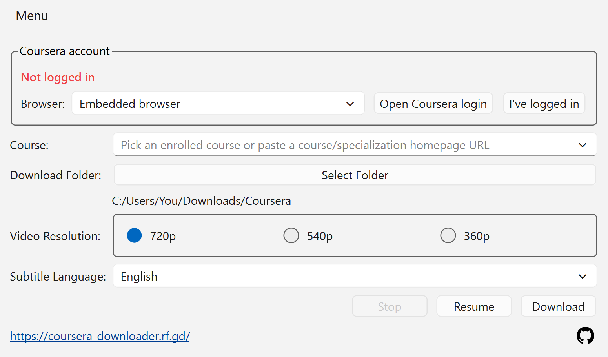

# Coursera Full Course Downloader

A Windows GUI app for downloading complete Coursera courses and specializations in one go.

- **Website:** https://coursera-downloader.rf.gd/
- **Releases:** https://github.com/touhid314/Coursera-Downloader/releases
- **Source:** https://github.com/touhid314/Coursera-Downloader

## Screenshots



### Downloading a course


## Features

- Download videos, subtitles, readings, quizzes, notebooks, assignments, and
  other available course resources.
- Pick from your enrolled courses or paste a course, specialization, or
  professional-certificate URL.
- Preserve Coursera's week, section, and lecture organization.

## Install on Windows

Download the latest installer from the
[project website](https://coursera-downloader.rf.gd/) or
[GitHub Releases](https://github.com/touhid314/Coursera-Downloader/releases).
Run the installer, then launch **Coursera Full Course Downloader** from the
desktop or Start menu.

The embedded login requires the Microsoft Edge WebView2 Runtime, which is
normally already installed on current Windows 10 and Windows 11 systems.

## Quick start

1. Keep **Embedded browser** selected and click **Open Coursera login**.
2. Sign in to Coursera. The app confirms the login and loads your enrolled
   courses.
3. Pick a course, or paste its Coursera URL.
4. Select the download folder, video quality, and subtitle language.
5. Click **Download**.

You must be enrolled in the selected course. For a specialization or
professional certificate, you must be enrolled in each course you want to
download.

## Run from source

Windows users can double-click `run_gui.bat`. It installs missing dependencies
on the first run and launches the application.

To run it manually:

```powershell
python -m venv .venv
.venv\Scripts\python.exe -m pip install -r requirements.txt
.venv\Scripts\python.exe main.py
```

## Development

Install the development tools and run the automated tests:

```powershell
.venv\Scripts\python.exe -m pip install -r requirements-dev.txt
.venv\Scripts\python.exe -m unittest discover -s tests -v
```

The Windows release process is documented in
[`release/README.md`](release/README.md). The short version is:

```text
release\build_app.bat
release\build_installer.bat
```

## Project structure

```text
main.py            Application entry point
run_gui.bat        Source launcher for Windows
src/gui/           PySide6 interface, login window, and Windows integration
src/core/          Coursera syllabus and download engine
src/services/      Authentication, settings, updates, and notifications
assets/            Application icons and static assets
tests/             Automated tests
release/           Build configuration, generated artifacts, and release guide
```

## Privacy

Coursera authentication cookies stay on the computer and the embedded-login
credential is stored using the operating system's credential vault. On startup,
the app records an anonymous installation identifier, country, app version,
platform, and time to measure usage. It does not collect the Coursera password.

## Responsible use

Download only material you are authorized to access. You are responsible for
following Coursera's terms and the rights attached to course content.

## License

This project is licensed under the
[Creative Commons Attribution-NonCommercial 4.0 International License](LICENSE).

[](https://creativecommons.org/licenses/by-nc/4.0/)
